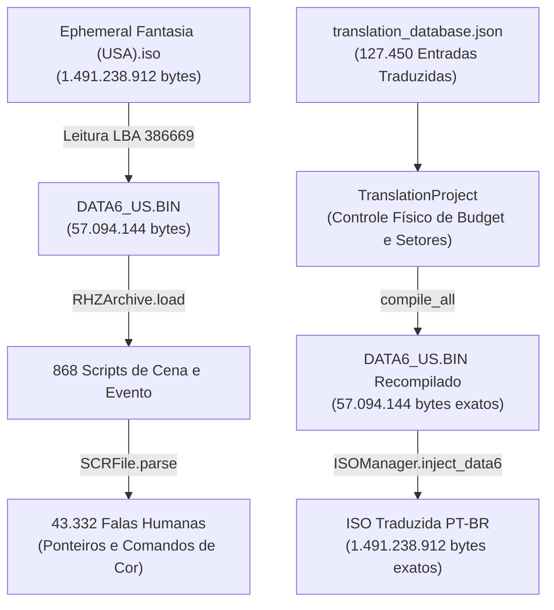

# Ephemeral Fantasia (PlayStation 2) — Tradução e Localização em Português do Brasil (PT-BR)

> [!IMPORTANT]
> **Status do Projeto**: 🟡 **Trabalho em Andamento (Work in Progress - WIP)**  
> **Progresso Geral**:
> - **Textos**: 100% traduzidos e revisados (43.332 falas de personagens e 127.450 strings de jogo).
> - **Gráficos & Menus**: Telas de combate, menus, minimapas e fontes acentuadas implementados.
> - **Harmonização Literária**: Equilíbrio sociolinguístico de demonstrativos (*este/esse, isto/isso*) finalizado.
> - **Fase Atual**: Playtesting integral na ROM para verificação de limites visuais de caixas de texto e polimento estético em emulador e hardware real.

---

## 1. Visão Geral do Jogo

*Ephemeral Fantasia* (lançado no Japão como *Reiselied: Ephemeral Fantasia* pela Konami em 2000 para o PlayStation 2) é um RPG único que combina exploração musical, combate estratégico por turnos e uma mecânica central de **Loop Temporal de 7 Dias**.

O jogador assume o papel de **Mouse**, um ladrão e menestrel errante acompanhado por **Patty** (sua guitarra falante mágica), contratado para tocar no casamento da Princesa Loreille com o misterioso Lorde Xelpherpolis na idílica ilha de Pandule. Ao fim da primeira semana, Mouse descobre que a ilha está presa em um feitiço de tempo selado onde o tempo reinicia ciclicamente e a população perde suas memórias recentes.

Cada NPC na ilha possui uma rotina horária própria, 24 horas por dia ao longo dos 7 dias da semana, tornando o mundo vivo e repleto de eventos baseados em tempo real.

---

## 2. Engenharia Reversa e Pipeline Técnico

O desenvolvimento da tradução exigiu a criação de uma suíte completa de engenharia reversa proprietária em Python, localizada na pasta [`editor/`](./editor/):



### Principais Componentes Técnicos Desenvolvidos

1. **`editor/core/rhz.py` (Arquivador RHZ)**:
   - Formato de arquivo comprimido proprietário da Konami que encapsula os 868 scripts do jogo.
   - Suporte a descompressão e reempacotamento binário com padding estrito de múltiplos de 2048 bytes (alinhamento de setor de DVD de PS2).

2. **`editor/core/scr.py` (Parser de Scripts de Cena)**:
   - Descompilação e remontagem de fluxos de eventos, ponteiros relativos de texto, tabelas de salto e tags de controle embutidas (cores hexadecimais `c`, pausas ``, quebras de linha e avanço de página).

3. **`editor/core/project.py` (Gerenciador de Projeto & Orçamento Físico)**:
   - Validação em tempo real de `max_safe`, `overflow` e `slack_to_sector` para garantir que nenhuma expansão textual quebre a tabela de conteúdo (TOC) da ROM.

4. **`editor/core/iso.py` (Injetor de Imagem ISO)**:
   - Injeção in-place no endereço LBA 386669, garantindo a integridade estrutural da ISO do PlayStation 2 sem corromper partições ou arquivos vizinhos.

5. **`editor/core/font_engine.py` (Motor de Tipografia)**:
   - Suporte aos glifos da língua portuguesa (á, é, í, ó, ú, â, ê, ô, ã, õ, ç, Á, É, Í, Ó, Ú, Â, Ê, Ô, Ã, Õ, Ç) com larguras de glifos proporcionais autênticas do PS2.

---

## 3. Processo de Tradução e Adaptação Literária

A tradução foi executada em **6 etapas temáticas e cronológicas**, guiada por uma rigorosa **Bíblia de Voz** documentada na pasta [`revisao_etapas/`](./revisao_etapas/):

| Etapa | Conteúdo e Arcos Narrativos | Volume de Falas |
| :--- | :--- | :---: |
| [**Dossiê de Personagens**](./revisao_etapas/DOSSIE_PERSONAGENS.md) | Bíblia de voz de protagonistas, aliados, antagonistas e NPCs. | Documento Transversal |
| [**Etapa 1**](./revisao_etapas/ETAPA_1_PROLOGO_E_DIA_1.md) | Prólogo marítimo, porto de Pandule, estalagem de Rinna e audiência real no palácio. | ~265 falas |
| [**Etapa 2**](./revisao_etapas/ETAPA_2_DIA_2_DESPERTAR_E_LOOP.md) | O despertar no quarto, o choque do tempo que voltou, Claire, Migarifo e o Loop de Pandule. | 324 falas |
| [**Etapa 3**](./revisao_etapas/ETAPA_3_DIAS_3_4_RECRUTAMENTO.md) | Recrutamento dos aliados: Rinna, General Bagoth, Lobo do Mar Kyte e a Besta de Ferro Grantus. | 378 falas |
| [**Etapa 4**](./revisao_etapas/ETAPA_4_DIAS_5_7_CLIMAX_E_FINAL.md) | Véspera das bodas, taça envenenada, invasão do palácio, Altar Sagrado, batalha final e epílogo. | 915 falas |
| [**Etapa 5**](./revisao_etapas/ETAPA_5_NPCS_E_ROTINAS.md) | Moradores urbanos de Pandule: mercado central, feirantes, guarda da cidade, crianças e professores. | 474 falas |
| [**Etapa 6**](./revisao_etapas/ETAPA_6_PERIFERIA_E_ZONA_RURAL.md) | Periferia operária (Bairro Leste), cortadores de pedra, caçadores, minas de carvão e balcão de Claire. | 412 falas |
| **Harmonização Global** | Equilíbrio sociolinguístico dos demonstrativos em 511 scripts da ROM. | 2.185 falas |

### Harmonização Sociolinguística dos Demonstrativos
Em vez de uma eliminação mecânica do "este/isto", o projeto implementou uma calibragem por registro social:
- **Registro Solene / Nobre / Sagrado (215 falas)**: O "este/esta/deste" foi preservado onde tem valor dramático autêntico (discursos marciais do General Bagoth, elegância da Princesa Loreille, tirania de Lorde Xelpherpolis, estátuas e inscrições em templos).
- **Registro Popular / Cotidiano (1.970 falas)**: A linguagem do povo das ruas, pescadores, comerciantes, crianças e os pensamentos sarcásticos da Patty foram adaptados para a naturalidade do português brasileiro falado (*"esse/essa/isso/desse/dessa/nesse/nessa"*).

---

## 4. Estrutura do Repositório

```text
ephemeral-fantasia-ps2-Ptbr/
├── database/
│   └── translation_database.json   # Banco de dados com as 127.450 strings traduzidas
├── editor/
│   ├── core/                       # Módulos centrais (RHZ, SCR, ISO, Fonte, Projeto)
│   ├── ui/                         # Interface gráfica de visualização e edição
│   └── app.py                      # Aplicação do Editor de Ephemeral Fantasia
├── graficos_extraidos/             # Texturas e elementos visuais traduzidos em PT-BR
│   ├── Combate/
│   ├── Menus_e_Telas/
│   ├── Mapas_e_Bussolas/
│   └── Minijogos_e_Cartas/
├── revisao_etapas/                 # Dossiês e árvores de revisão narrativa
│   ├── 00_INDICE_GERAL.md
│   ├── DOSSIE_PERSONAGENS.md
│   ├── ETAPA_1_PROLOGO_E_DIA_1.md
│   ├── ETAPA_2_DIA_2_DESPERTAR_E_LOOP.md
│   ├── ETAPA_3_DIAS_3_4_RECRUTAMENTO.md
│   ├── ETAPA_4_DIAS_5_7_CLIMAX_E_FINAL.md
│   ├── ETAPA_5_NPCS_E_ROTINAS.md
│   └── ETAPA_6_PERIFERIA_E_ZONA_RURAL.md
├── scripts/
│   └── patch_iso.py                # Script CLI para aplicar o patch em uma ISO limpa
├── .gitignore                      # Proteção contra upload de ISOs e dumps proprietários
├── README.md                       # Documentação mestre do projeto
└── requirements.txt                # Dependências Python
```

---

## 5. Como Compilar a Tradução (Gerar a ISO PT-BR)

### Pré-requisitos
* Python 3.10 ou superior instalado.
* Imagem ISO original de *Ephemeral Fantasia (USA)* (`SLUS_201.69` / 1.491.238.912 bytes).

### Passos de Execução
1. Clone este repositório:
   ```bash
   git clone https://github.com/Kasszs/ephemeral-fantasia-ps2-Ptbr.git
   cd ephemeral-fantasia-ps2-Ptbr
   ```

2. Instale as dependências:
   ```bash
   pip install -r requirements.txt
   ```

3. Execute o script de injeção passando o caminho da sua ISO:
   ```bash
   python scripts/patch_iso.py "caminho/para/Ephemeral Fantasia (USA).iso"
   ```

O script criará um backup de segurança e aplicará todas as traduções e alinhamentos de setores na imagem do jogo.

---

## 6. Próximos Passos (Roadmap WIP)

- [x] Extração e engenharia reversa do formato RHZ/SCR.
- [x] Tradução integral dos 868 scripts e 127.450 strings.
- [x] Revisão literária humanizada das Etapas 1 a 6.
- [x] Adaptação de texturas de combate, minimapas, bússola e menus.
- [x] Balanceamento sociolinguístico de demonstrativos.
- [ ] Playtesting completo do início ao fim (Dia 1 ao Dia 7).
- [ ] Verificação de formatação e limites visuais em diálogos de lojas e sidequests secundárias.
- [ ] Lançamento do patch público para a comunidade de retrogaming.

---

**Autor / Tradutor**: Kassio (Kasszs)  
**Plataforma**: PlayStation 2  
**Gênero**: RPG de Loop Temporal / Fantasia  
