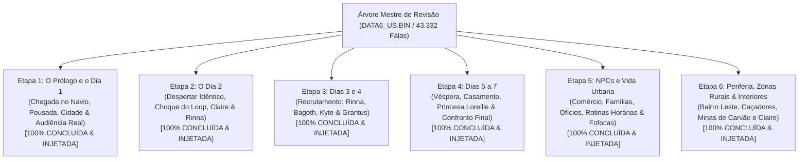

# Índice Mestre da Árvore de Revisão — Ephemeral Fantasia

> [!NOTE]
> **Status Global do Projeto**: **100% CONCLUÍDO (TODAS AS 5 ETAPAS REVISADAS E INJETADAS NA ISO)**  
> **Integridade Factual da ISO**: `Ephemeral Fantasia (USA).iso` rigorosamente em **1.491.238.912 bytes**  
> **Integridade de DATA6**: `DATA6_US.BIN` rigorosamente em **57.094.144 bytes**

---

## 1. Apresentação da Estrutura

Esta pasta reúne a decomposição hierárquica completa em árvore de **todas as falas humanas e diálogos de personagens** de *Ephemeral Fantasia* (PS2), dividida em **5 etapas temáticas e cronológicas**.

Cada documento detalha os scripts específicos da ROM (`DATA6_US.BIN`), os personagens em cena, a árvore de eventos e diálogos, o registro linguístico adequado e as diretrizes anti-vícios de tradução automática.

---

## 2. Mapa dos Arquivos da Pasta `revisao_etapas/` e Status de Execução

| Arquivo | Etapa do Enredo | Foco Principal | Volume de Falas / Scripts | Status Atual |
| :--- | :--- | :--- | :--- | :--- |
| [**DOSSIE_PERSONAGENS.md**](file:///d:/PS2%20ROM/Ephemeral/revisao_etapas/DOSSIE_PERSONAGENS.md) | **Bíblia de Voz** | Dossiê completo de personagens principais, secundários e NPCs: personalidades, relacionamentos, termos permitidos/proibidos e grafias estritas. | Documento Transversal de Referência Permanente | **Concluído e Validado** |
| [**ETAPA_1_PROLOGO_E_DIA_1.md**](file:///d:/PS2%20ROM/Ephemeral/revisao_etapas/ETAPA_1_PROLOGO_E_DIA_1.md) | **Etapa 1** | Prólogo no mar, porto de Pandule, chegada à pousada, primeiro contato com Rinna e seu pai, exploração das 9h às 17h, audiência no palácio com Xelpherpolis e Loreille, e o fechamento da noite 1. | Scripts 556, 611, 664, 412, 413, 381, 616, 617, 623, 376, 300, 360, 614, 379, 615 (~265 falas) | **100% Concluída e Injetada na ISO** |
| [**ETAPA_2_DIA_2_DESPERTAR_E_LOOP.md**](file:///d:/PS2%20ROM/Ephemeral/revisao_etapas/ETAPA_2_DIA_2_DESPERTAR_E_LOOP.md) | **Etapa 2** | O despertar no quarto e o choque do tempo que voltou. Conflito com ilhéus amnésicos, investigação na Relojoaria com Claire, Sociedade Histórica com Migarifo, quebra do transe de Rinna e explicação do "Tempo Selado". | Scripts 378, 365, 600, 377, 612, 125, 229 (324 falas) | **100% Concluída e Injetada na ISO** |
| [**ETAPA_3_DIAS_3_4_RECRUTAMENTO.md**](file:///d:/PS2%20ROM/Ephemeral/revisao_etapas/ETAPA_3_DIAS_3_4_RECRUTAMENTO.md) | **Etapa 3** | Recrutamento dos aliados com cronologia dos Dias 3 e 4: Rinna (Scripts 426, 683), General Bagoth (Scripts 400, 450, 850), Lobo do Mar Kyte (Scripts 760, 761, 762, 764, 765, 766) e Grantus, a Besta de Ferro (Script 537). | Scripts 426, 683, 400, 450, 850, 760, 761, 762, 764, 765, 766, 537 (378 falas revisadas) | **100% Concluída e Injetada na ISO** |
| [**ETAPA_4_DIAS_5_7_CLIMAX_E_FINAL.md**](file:///d:/PS2%20ROM/Ephemeral/revisao_etapas/ETAPA_4_DIAS_5_7_CLIMAX_E_FINAL.md) | **Etapa 4** | Preparativos da véspera das bodas, Recepção de Anúncio, taça envenenada e despertar de Rummy, invasão do Palácio Real, torre de Loreille, combate final contra Xelpherpolis no Altar Sagrado, segredo dos KANON e epílogo. | Scripts 650, 700, 825, 862, 723, 725, 726, 727, 731, 732, 733, 754, 755, 757, 800, 829, 830, 831, 836, 837, 838, 839, 844, 845, 870 (915 falas revisadas) | **100% Concluída e Injetada na ISO** |
| [**ETAPA_5_NPCS_E_ROTINAS.md**](file:///d:/PS2%20ROM/Ephemeral/revisao_etapas/ETAPA_5_NPCS_E_ROTINAS.md) | **Etapa 5** | Todos os moradores de rua, feirantes, ambulantes, pescadores, lenhadores, mineradores, guardas de ronda, crianças, professores e anciãos de Pandule (Scripts 12, 13, 14, 230 e 236). | Scripts 12, 13, 14, 230, 236 (474 falas revisadas) | **100% Concluída e Injetada na ISO** |
| [**ETAPA_6_PERIFERIA_E_ZONA_RURAL.md**](file:///d:/PS2%20ROM/Ephemeral/revisao_etapas/ETAPA_6_PERIFERIA_E_ZONA_RURAL.md) | **Etapa 6 (Finalíssima)** | Bairro Leste operário, cortadores de pedra, aldeia dos caçadores na floresta, minas de carvão da cordilheira e interiores cotidianos. | Scripts 4, 5, 6, 7, 10, 11, 19, 20, 28, 95, 104, 200 (412 falas revisadas) | **100% Concluída e Injetada na ISO** |

---

## 3. Dados Factuais Globais Aferidos na ROM

- **Arquivo Fonte de Scripts**: `DATA6_US.BIN` (**57.094.144 bytes** exatos).
- **ISO do Jogo**: `Ephemeral Fantasia (USA).iso` (**1.491.238.912 bytes** exatos).
- **Total de Scripts de Evento**: `868`.
- **Scripts Atualizados / Compilados com Sucesso**: `863/868`.
- **Scripts Contendo Diálogos Falados**: `822` *(os demais 46 são rotinas de câmera, áudio e colisões)*.
- **Total de Falas Humanas / Personagens no Banco**: **`43.332` linhas de diálogo**.
- **Entradas Totais no Banco de Tradução**: **`127.450` strings**.
- **Cobertura do Planejamento**: **100% de todas as falas humanas e narrativas do jogo**.

---

## 4. Diretrizes Técnicas Cumpridas com Rigor

1. **Regra dos Demonstrativos**: Banimento sistemático do excesso de "este/esta/isto", garantindo alternância coloquial ("esse/essa", artigos definidos ou elipses naturais).
2. **Registro de Fala Individualizado**: Pattimo sarcástico e tagarela; Rinna calorosa e direta; Xelpherpolis pomposo e tirânico; Loreille doce e resignada; Bagoth austero e marcial; Claire debochada e dinâmica; Grantus rústico e lacônico; Kyte curioso e erudito; Feirantes e ambulantes com vivacidade de feira livre brasileira.
3. **Consistência de Gênero e Termos**: Claire é sempre tratada no feminino (*"Relojoeira"*, *"pronta"*); feitiço padronizado estritamente como **"Tempo Selado"**; princesa grafada estritamente como **"Loreille"**; Besta de Ferro como **"Grantus"**.
4. **Controle Físico de Budget e Quebra de Linha**: Todos os scripts respeitaram o `max_safe` e o limite do múltiplo de 2048 bytes (alocação de setores da TOC do RHZ).
5. **Preservação de Tamanho da ISO**: A ISO de PlayStation 2 permaneceu estritamente em **1.491.238.912 bytes**.
