# Árvore da Etapa 1: O Prólogo e o Dia 1

## 1. Visão Geral da Etapa

A Etapa 1 marca o início da aventura de *Ephemeral Fantasia*. O bardo Mouse e seu alaúde mágico falante, Pattimo, viajam de navio até a remota Ilha Pandule a convite do governante local, Lorde Xelpherpolis, para se apresentarem no iminente Casamento Real com a Princesa Loreille. 

Nesta etapa, o jogador experimenta o mundo antes de compreender que o tempo está preso em um ciclo fechado de repetição.

```mermaid
flowchart TD
    E1["Etapa 1: O Prólogo e o Dia 1"] --> P["1. Prólogo no Mar & Desembarque (Script 556)"]
    E1 --> INN["2. A Pousada & Boas-Vindas (Scripts 611, 664, 412, 413)"]
    E1 --> TWN["3. Exploração Diurna da Cidade (9h às 17h) (Scripts 1..25, 300)"]
    E1 --> AUD["4. A Audiência Real das 17h (Script 300, 611, 650)"]
    E1 --> NGT["5. O Banquete da Noite 1 & O Feitiço do Tempo"]

    P --> P1["Diálogo no tombadilho do navio (Marinheiro exalta a ilha)"]
    P --> P2["Pattimo resmunga sobre a viagem e o convite nobre"]
    P --> P3["Atracagem no Porto de Pandule"]

    INN --> IN1["Rummy conduz Mouse ao quarto de hóspedes"]
    INN --> IN2["Aviso solene: 'Xelpherpolis o receberá às 17h'"]
    INN --> IN3["Primeira conversa com Rinna e o Estalajadeiro"]

    TWN --> TW1["Moradores ansiosos pelo festival e casamento"]
    TWN --> TW2["Comerciantes locais vendendo suprimentos"]
    TWN --> TW3["Pattimo orienta Mouse a não se atrasar para o palácio"]

    AUD --> AU1["Guarda escolta Mouse pelos salões do Palácio de Pandule"]
    AUD --> AU2["Audiência com Lorde Xelpherpolis: postura fria e tirânica"]
    AUD --> AU3["Princesa Loreille: olhar melancólico e conformismo doloroso"]
    AUD --> AU4["Xelpherpolis encomenda a canção nupcial do bardo"]

    NGT --> NG1["Retorno para descansar na Pousada"]
    NGT --> NG2["Ativação silenciosa do feitiço 'Tempo Selado' à meia-noite"]
```

---

## 2. Inventário de Scripts e Cenas Mapeadas

| Script ID | Arquivo de Asset (.rhe) | Localização no Jogo | Personagens / Locutores | Linhas de Diálogo |
| :--- | :--- | :--- | :--- | :--- |
| **Script 556** | `.\prologue\pro_00.rhe` a `pro_03.rhe` | Convés do Navio / Porto | Marinheiro, Pattimo, Mouse | 28 diálogos |
| **Script 611** | `.\d121\d121_01.rhe`, `.\d123` | Quarto da Pousada / Corredores | Guarda Real Rummy, Pattimo, Mouse | 96 diálogos |
| **Script 664** | `.\d366\d366_01.rhe` | Térreo da Pousada (Balcão) | Estalajadeiro (Pai de Rinna), Pattimo | 32 diálogos |
| **Script 412** | `.\d366\d366_01a.rhe` | Pousada (Reações de Descanso) | Estalajadeiro, Rinna | 55 diálogos |
| **Script 413** | `.\d367\d367_01.rhe` | Entrada do Palácio / Portaria | Rinna, Guardas | 60 diálogos |
| **Script 300** | Mapas centrais de evento | Cidade / Entrada Leste do Palácio | Pattimo, Guarda Rummy, Guardas Reais | 282 diálogos |
| **Scripts 1..25** | Tabelas de eventos iniciais | Praças, Cais e Jardins | Cidadãos, Guardas, Comerciantes | ~1.200 diálogos |

---

## 3. Matriz de Personagens e Registro de Voz (Dia 1)

### Mouse (O Bardo Silencioso)
- **Papel**: Protagonista. Não possui falas convencionais em caixas de diálogo, mas expressa suas vontades por opções de escolha (`SIM` / `NÃO`) e reações corporais.
- **Registro**: Modesto, atento e corajoso.

### Pattimo (O Alaúde Mágico)
- **Papel**: A verdadeira voz de Mouse.
- **Registro**: **Cínico, mordaz, carismático e afetuoso com Mouse.** Faz piadas sobre o tédio no navio, zomba da arrogância dos nobres e alerta Mouse para não bancar o herói ingênuo.
- **Exemplo de Tom**:
  - *Inglês*: `What are you doing, Mouse?! Hurry up and get to the Princess's room! There isn't much time!`
  - *PT Revisado*: `O que você ainda tá esperando, Mouse?! Corre logo pro quarto da Princesa, o tempo tá voando!`

### Guarda Real Rummy
- **Papel**: O oficial designado por Xelpherpolis para recepcionar e vigiar o bardo.
- **Registro**: Polido, protocolar e rigorosamente pontual. Fala em tom de dever militar.

### Rinna & O Estalajadeiro
- **Papel**: Moradores locais e donos da pousada.
- **Registro**: Calorosos, acolhedores e simples. Rinna é jovem, solícita e informal (**nunca tratar Mouse por "o senhor"**).

### Lorde Xelpherpolis
- **Papel**: O governante déspota da Ilha Pandule.
- **Registro**: **Superior, teatral, calculista e aristocrático.** Não pede; ordena com cortesia venenosa.

### Princesa Loreille
- **Papel**: A noiva cativa.
- **Registro**: Doce, formal, abatida e distante. Carrega um peso silencioso na voz.

---

## 4. Checklist Anti-Vícios de Tradução Automática na Etapa 1

- [ ] **Eliminar demonstrativos mecânicos**:
  - `556:13`: Substituir *"Oh, mas isto não é...?!"* por *"Ei, espera aí, isso não é...?!"*.
  - `611:2`: Substituir *"Este é o seu quarto durante a sua estadia..."* por *"Aqui está o seu quarto para a sua estadia..."*.
- [ ] **Corrigir pronomes de tratamento artificiais**:
  - `413:2`: Remover *"o senhor"* da fala de Rinna, usando o tratamento jovem e caloroso *"você"*.
- [ ] **Ajustar quebras e estouros de caixa (`has_overflow`)**:
  - Reduzir as linhas do `Script 300` onde avisos de estouro foram sinalizados na ROM original.
- [ ] **Eliminar conectivos engessados**:
  - Banir *"no entanto"*, *"portanto"*, substituindo por pausas pontuadas ou conjunções coloquiais (*"mas"*, *"só que"*).
