# Árvore da Etapa 2: O Dia 2 — O Despertar e a Descoberta da Maldição

> **Status da Etapa**: **100% CONCLUÍDA E INJETADA NA ISO**  
> **ISO Alvo**: `Ephemeral Fantasia (USA).iso` (1.491.238.912 bytes intactos)  
> **Archive Compilado**: `DATA6_US.BIN` (57.094.144 bytes)  
> **Entradas Revisadas nesta Etapa**: 324 diálogos em 7 scripts centrais.

---

## 1. Visão Geral da Etapa

A Etapa 2 representa a virada conceitual e narrativa central de *Ephemeral Fantasia*. Mouse e Pattimo acordam no quarto da Pousada esperando o dia seguinte, mas descobrem com espanto que o Dia 1 está se repetindo exatamente nos mesmos minutos e com as mesmas palavras de cada morador. 

Apenas a dupla mantém a memória intacta. A missão passa a ser investigar as origens dessa anomalia e encontrar uma forma de despertar os moradores da hipnose temporal, culminando na libertação da consciência de Rinna e no alinhamento com os futuros aliados da resistência.

```mermaid
flowchart TD
    E2["Etapa 2: O Dia 2 & A Quebra do Transe"] --> WAK["1. O Despertar Repetido na Pousada (Script 378)"]
    E2 --> STR["2. Conflito com Ilhéus Amnésicos & O Estalajadeiro"]
    E2 --> INV["3. Investigação Temporal (Relojoaria & Sociedade Histórica)\n(Scripts 365, 600, 125, 229)"]
    E2 --> RIN["4. A Conferência dos Despertos & Choque de Rinna\n(Scripts 377, 612)"]
    E2 --> PAC["5. O Pacto Secreto & O Início da Resistência"]

    WAK --> WK1["O Estalajadeiro repete exatamente a mesma conversa matinal"]
    WAK --> WK2["Pattimo explica o looping: 'O tempo nesta ilha foi distorcido!'"]
    WAK --> WK3["A confirmação do feitiço: 'Tempo Selado' (Time's Closed)"]

    STR --> ST1["Moradores agem como se o dia anterior nunca tivesse existido"]
    STR --> ST2["Estalajadeiro se confunde sobre quantos anos a pousada existe"]
    STR --> ST3["Pattimo decide não fugir: 'Recuar agora seria coisa de covarde!'"]

    INV --> IN1["Oficina da Relojoaria: Claire acordada, ressaca matinal e deboche"]
    INV --> IN2["Correção estrita de gênero: 'Relojoeira' e postura feminina ágil"]
    INV --> IN3["Sociedade Histórica: Erudito Migarifo revela a profecia dos ponteiros"]
    INV --> IN4["Livraria de Pandule: Barboni e títulos com 'Lorde Xelpherpolis'"]

    RIN --> RN1["Reunião estratégica na pousada com os aliados libertos"]
    RIN --> RN2["Variações de grupo: Rummy, Claire, Kyte e General Bagoth"]
    RIN --> RN3["Rinna escuta a verdade aterradora: 'Lorde Xelpherpolis é o Inferno do Tempo!'"]

    PAC --> PC1["Rinna recupera a lucidez e aceita a dolorosa realidade"]
    PAC --> PC2["Início formal da busca pelos companheiros de alma"]
```

---

## 2. Inventário de Scripts Revisados e Injetados

| Script ID | Arquivo de Asset (.rhe) | Contexto Narrativo | Personagens Principais | Diálogos Revisados | Status / Headroom |
| :--- | :--- | :--- | :--- | :--- | :--- |
| **Script 378** | `.\d123\d123_01.rhe` a `03.rhe` | Quarto da Pousada (Manhã do Dia 2) | Pattimo, Pai da Rinna | 105 diálogos | **Concluído (+36 bytes)** |
| **Script 365** | `.\d110\d110_01.rhe`, `02a.rhe` | Relojoaria de Pandule | Claire (Relojoeira), Pattimo | 18 diálogos | **Concluído (+27.833 bytes)** |
| **Script 600** | `.\d110\d110_01.rhe`, `02a.rhe` | Relojoaria de Pandule (Espelho) | Claire (Relojoeira), Pattimo | 34 diálogos | **Concluído (+193 bytes)** |
| **Script 377** | `.\d122\d122_01.rhe`, `01x/y/z` | Salão da Pousada (Conferência) | Rummy, Kyte, Bagoth, Rinna, Pattimo | 158 diálogos | **Concluído (+590 bytes)** |
| **Script 612** | `.\d122\d122_01.rhe`, `01x/y/z` | Salão da Pousada (Espelho) | Rummy, Kyte, Bagoth, Claire, Rinna | 158 diálogos | **Concluído (+527 bytes)** |
| **Script 125** | `.\d125\d125_01.rhe` | Sociedade Histórica de Pandule | Erudito Migarifo, Livros | 66 diálogos | **Concluído (+40.149 bytes)** |
| **Script 229** | Mapas centrais de livraria | Livraria de Pandule | Balconista Barboni, Moradores | 55 diálogos | **Concluído (+40.218 bytes)** |

---

## 3. Matriz de Personagens e Conflito Dramático (Dia 2)

### Pattimo (O Alaúde Investigador)
- **Papel**: Condutor da investigação e voz ativa de Mouse.
- **Registro**: **Impaciente, sarcástico, mas profundamente didático quando a gravidade da situação exige.** Alterna momentos de deboche com discursos sérios sobre a manipulação mágica de Xelpherpolis.
- **Destaque nesta Etapa**:
  - *Inglês*: `Thanks to Xelpherpolis's magic, time on this island has been warped. That's the meaning of "Time's Closed". As far as I can tell, the islanders unknowingly repeat the same few days.`
  - *PT Revisado*: `Por causa da magia de Xelpherpolis, o tempo nesta ilha foi distorcido. É esse o significado de 'Tempo Selado'. Pelo que deu pra notar, o povo daqui repete os mesmos poucos dias sem nem desconfiar.`
  - *Plano de Carreira*: Resgatada a fala censurada na tradução antiga: *"Nosso verdadeiro ganha-pão é... a gatunagem!"*.

### Claire (A Relojoeira de Língua Afiada)
- **Papel**: Artífice de relógios misteriosa e aliada leal.
- **Registro**: Desbocada, espirituosa, segura de si e irônica. Trata Mouse carinhosamente por *"garotinho"* ou *"pivete"*.
- **Correção de Gênero Crucial**: Erro crasso da versão anterior (*"Relojoeiro"* e *"estou pronto"*) eliminado; agora grafada corretamente como **`Relojoeira`** e falas ajustadas no feminino (*"estou pronta"*, *"prontinha"*).

### Marinheiro Kyte
- **Papel**: Lobo do mar impulsivo e direto.
- **Registro**: Gírias marítimas e coloquialismo direto (*"cabra"*, *"não tem conversa fiada"*, *"aquele crápula do Xelpherpolis"*).

### General Bagoth
- **Papel**: Comandante militar honrado em conflito moral.
- **Registro**: Solene, culto, marcial (*"Lorde Mouse"*, *"têmpera moral"*, *"Laço Temporal"*, *"forjar aliança"*).

### Rinna (O Despertar Doloroso)
- **Papel**: A jovem anfitriã que rompe o transe hipnótico.
- **Registro**: O terror de ouvir nos corredores da própria pousada que o governante venerado é o arquiteto do "Inferno do Tempo".

---

## 4. Checklist Anti-Vícios de Tradução Automática na Etapa 2

- [x] **Padronização do Feitiço Central**:
  - Garantido o termo estrito **"Tempo Selado"** para *Time's Closed* em todos os monólogos de Pattimo.
- [x] **Eliminação de demonstrativos artificiais**:
  - Substituição sistemática de "este/esta" por "esse/essa" e artigos naturais em todas as explicações da maldição.
- [x] **Correções de Gênero**:
  - Claire estabelecida como **Relojoeira** nos cabeçalhos e em suas flexões verbais.
- [x] **Restauração de Fidelidade e Sem Censura**:
  - Pattimo reassume seu humor ácido e ambições de ladroagem sem eufemismos.
  - Kyte recupera seu tom rude contra Xelpherpolis.
- [x] **Budget e Integridade Físicos**:
  - Todos os 7 scripts compilados com `overflow: False` e headroom positivo verificado.
  - ISO mantida rigorosamente em **1.491.238.912 bytes**.
