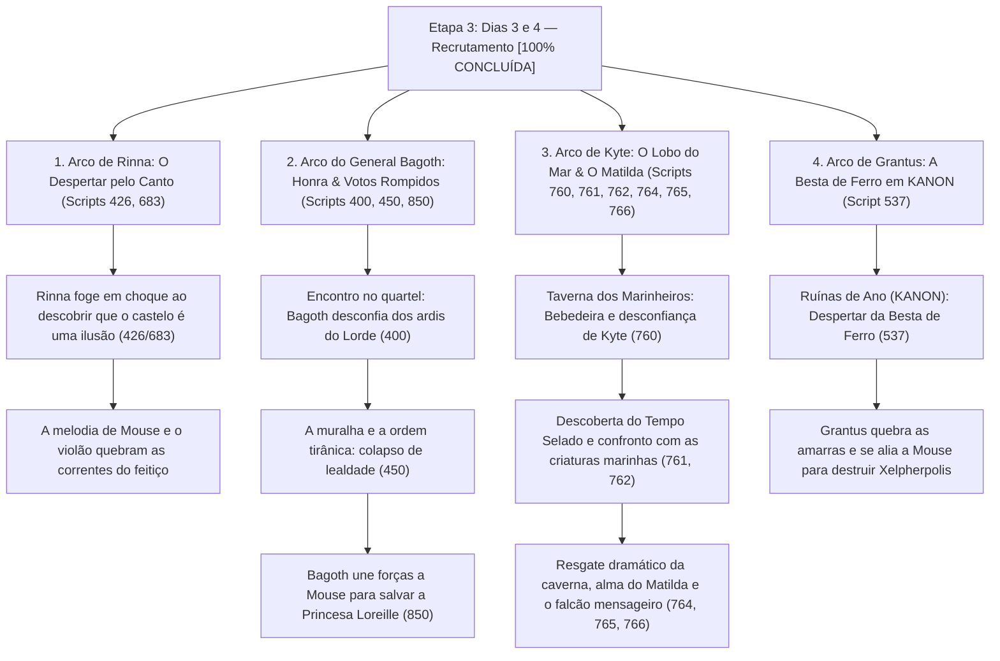

# Árvore da Etapa 3: Dias 3 e 4 — Investigação e Recrutamento dos Companheiros [100% CONCLUÍDA]

## 1. Visão Geral da Etapa (STATUS: CONCLUÍDA E INJETADA NA ISO)

Com a cumplicidade de Rinna e o conhecimento sobre o "Tempo Selado", Mouse e Pattimo passam da sobrevivência para a ofensiva nos Dias 3 e 4. Como quebrar o feitiço de Xelpherpolis exige força militar, perícia arcana e conhecimento do palácio, a dupla percorre a ilha aproveitando a cronologia dos eventos para recrutar quatro aliados cruciais: **Rinna**, **General Bagoth**, o marinheiro **Kyte** e o guerreiro **Grantus** (a Besta de Ferro).

---

## 2. Inventário de Scripts, Orçamentos e Cenas Mapeadas

| Script ID | Arquivo de Asset (.rhe) | Localização no Jogo | Personagens Principais | Status / Orçamento |
| :--- | :--- | :--- | :--- | :--- |
| **Script 426** | `.\da404\da404_01.rhe` | Quartel do Palácio | Rinna, Pattimo, Mouse | **100% Concluído** (+49 B livres) |
| **Script 683** | `.\d510\d510_01.rhe` | Jardins da Pousada | Rinna, Pattimo, Mouse | **100% Concluído** (+49 B livres) |
| **Script 400** | `.\d250\d250_01.rhe`, `02.rhe` | Quartel do Palácio / Pátio | General Bagoth, Pattimo, Mouse | **100% Concluído** (+29.055 B livres) |
| **Script 450** | `.\d4116\d4116_01.rhe` a `05.rhe` | Muralha / Posto Avançado | Bagoth, Guardas, Pattimo | **100% Concluído** (+157 B livres) |
| **Script 850** | `.\da404\da404_01.rhe`, `02.rhe` | Salão de Armas | Bagoth, Pattimo, Mouse | **100% Concluído** (+48.340 B livres) |
| **Script 760** | `.\dg156\dg156_01.rhe` | Taverna do Porto | Kyte, Wexler, Filho de Lordan | **100% Concluído** (+21 B livres) |
| **Script 761** | `.\dg156\dg156_02.rhe` | Cais de Pandule | Kyte, Pattimo, Mouse | **100% Concluído** (+58 B livres) |
| **Script 762** | `.\dg156\dg156_03.rhe` | Entrada do Palácio | Kyte, Pattimo, Mouse | **100% Concluído** (+18 B livres) |
| **Script 764** | `.\dg157\dg157_01.rhe` | Caverna do Cais | Kyte, Pattimo, Mouse | **100% Concluído** (+21 B livres) |
| **Script 765** | `.\dg157\dg157_02.rhe` | Saída da Caverna | Kyte, Pattimo, Rummy | **100% Concluído** (+34 B livres) |
| **Script 766** | `.\dg157\dg157_03.rhe` | Enseada do Porto | Kyte, Pattimo, Rummy, Mouse | **100% Concluído** (+73 B livres) |
| **Script 537** | `.\d210\d210_01.rhe` | Ruínas de Ano (KANON) | Grantus, Pattimo, Mouse | **100% Concluído** (+223 B livres) |

---

## 3. Matriz de Personagens e Registro de Voz (Aliados da Etapa 3)

### Rinna (A Ladra Sensível e Rebelde)
- **Papel**: Furtividade e velocidade.
- **Registro**: **Jovem, assustada inicialmente com o loop, mas vibrante e leal.** Chora ao perceber a armadilha do casamento, mas ganha coragem com as canções de Mouse.

### Capitão Kyte (O Lobo do Mar)
- **Papel**: Guerreiro arrojado, ataque com arpão.
- **Registro**: **Grosseiro, bem-humorado, bebedor incorrigível, leal à tripulação do falecido navio Matilda.**
- **Correção Histórica**: Todos os scripts 760 a 766 continham o locutor erroneamente creditado a Rummy na tradução antiga. Restaurado e calibrado com fala maruja legítima (*"camarada"*, *"marujos"*, *"trago"*, *"marmanjos"*, *"casca-grossa"*).

### General Bagoth (O Guerreiro Honrado)
- **Papel**: Paladino, liderança tática e armadura pesada.
- **Registro**: **Marcial, grave, solene e respeitoso.** Fala com o peso do dever, quebrando seu juramento ao tirano em nome da verdadeira honra da ilha.

### Grantus (A Besta de Ferro)
- **Papel**: Força bruta e resistência colossal.
- **Registro**: **Direto, vigoroso, honesto e humilde.** Nome estritamente canônico: **Grantus** (*nunca Grant*).

---

## 4. Validação Técnica e Compilação
- **Total de falas revisadas nesta etapa**: 378 entradas.
- **Validação de Buffer**: 12 de 12 scripts com `overflow: False`.
- **Tamanho do DATA6_US.BIN**: Rigorosamente 57.094.144 bytes.
- **Tamanho da ISO**: Rigorosamente 1.491.238.912 bytes.
