# Árvore da Etapa 4: Dias 5 a 7 — O Clímax, a Libertação de Loreille e o Epílogo [100% CONCLUÍDA]

## 1. Visão Geral da Etapa (STATUS: CONCLUÍDA E INJETADA NA ISO)

A Etapa 4 é o ápice narrativo de *Ephemeral Fantasia*. Com o grupo de companheiros completo e o segredo do feitiço desvendado, Mouse e seus aliados avançam para impedir o Casamento Real antes que o ciclo temporal se feche definitivamente e condene a Ilha Pandule à estagnação perpétua. 

Esta etapa reúne **25 scripts cruciais** do `DATA6_US.BIN`, totalizando **915 falas revisadas**, divididas em 5 blocos dramáticos:

```mermaid
flowchart TD
    E4["Etapa 4: Dias 5 a 7 — O Clímax & Epílogo [100% CONCLUÍDA]"] --> B1["Bloco 1: Véspera do Casamento & Aposentos Reais\n(Scripts 650, 700, 825, 862)"]
    E4 --> B2["Bloco 2: A Trama da Taça & Despertar de Rummy\n(Scripts 723, 725, 726, 727, 731, 732, 733)"]
    E4 --> B3["Bloco 3: A Torre de Loreille & O Relógio Quebrado\n(Scripts 754, 755, 757, 800)"]
    E4 --> B4["Bloco 4: O Confronto no Altar & Derrota do Tirano\n(Scripts 829, 830, 831, 836, 837, 838, 839)"]
    E4 --> B5["Bloco 5: O Amanhã Conquistado, Despedida & Epílogo\n(Scripts 844, 845, 870)"]

    B1 --> B1a["Rummy e Mouse no jantar privado: vinho, ciúme e desabafos (650)"]
    B1 --> B1b["Xelpherpolis e Loreille na sacada: a frieza do dramaturgo tirano (700)"]
    B1 --> B1c["O banquete nupcial e o falso ataque de Gallhint desvendado (825)"]

    B2 --> B2a["O brinde dos tesouros reais com a taça de líquido explosivo (723, 725, 726)"]
    B2 --> B2b["Despertar de Rummy: superação do ciúme e quebra do feitiço (727)"]
    B2 --> B2c["Grantus entrega a chave do quarto de Loreille e Rinna é salva (731)"]
    B2 --> B2d["'É o alvorecer do último dia!' e o lamento de Ano (732, 733)"]

    B3 --> B3a["Loreille implora pela fuga de Mouse diante do poder de Xelpherpolis (754, 755)"]
    B3 --> B3b["Xelpherpolis congela o tempo sobre a derrota momentânea (757)"]
    B3 --> B3c["O Relógio Quebrado de Loreille restaura as memórias do mundo real (800)"]

    B4 --> B4a["O Altar Sagrado: Xelpherpolis em sua forma monstruosa (829)"]
    B4 --> B4b["União dos aliados, a canção de Mouse e o despertar real de Loreille (830)"]
    B4 --> B4c["A sobrecarga de poder: o tirano queima como uma cigarra (831)"]
    B4 --> B4d["Ano, Gallhint e o fim definitivo do 'verão sem fim' (836..839)"]

    B5 --> B5a["Pattimo e Mouse refletem com sinceridade: ladrões, não paladinos (844, 845)"]
    B5 --> B5b["O espelho da Magia do Tempo e o novo vento no cais (870)"]
```

---

## 2. Inventário Exaustivo de Scripts e Orçamentos de Buffer Validados

| Bloco | Script ID | Arquivo .rhe | Contexto e Ambiente | Personagens | Status / Folga Livre |
| :--- | :--- | :--- | :--- | :--- | :--- |
| **B1** | **650** | `.\d258` | Restaurante do Palácio | Rummy, Mouse, Pattimo, Garçom | **Aprovado** (+428 B livres) |
| **B1** | **700** | `.\d498` | Sacada dos Aposentos Reais | Xelpherpolis, Loreille | **Aprovado** (+35.488 B livres / 16 setores) |
| **B1** | **825** | `.\d3244` | Salão de Festas do Palácio | Xelpherpolis, Loreille, Gallhint, Bagoth | **Aprovado** (+107 B livres) |
| **B1** | **862** | `.\da424` | Corredor do Palácio | Dama da Corte, Mouse | **Aprovado** (+61.265 B livres) |
| **B2** | **723** | `.\d4120` | Salão do Brinde Real | Xelpherpolis, Loreille, Mouse | **Aprovado** (+69 B livres) |
| **B2** | **725** | `.\d4120` | Salão do Trono / Acusação | Xelpherpolis, Rummy, Loreille | **Aprovado** (+171 B livres) |
| **B2** | **726** | `.\d4121` | Variante do Brinde Real | Xelpherpolis, Mouse | **Aprovado** (+108 B livres) |
| **B2** | **727** | `.\d4122` | Salão de Entrada | Rummy, Pattimo, Mouse | **Aprovado** (+52 B livres) |
| **B2** | **731** | `.\d5126` | Portão das Ruínas | Grantus, Rinna, Pattimo, Mouse | **Aprovado** (+119 B livres) |
| **B2** | **732** | `.\d5130` | Transição do 7º Dia | Xelpherpolis | **Aprovado** (+58.369 B livres) |
| **B2** | **733** | `.\d5132` | Laboratório de Alquimia | Cientista Ano, Pattimo | **Aprovado** (+53.927 B livres) |
| **B3** | **754** | `.\d5146` | Torre Leste do Palácio | Loreille, Xelpherpolis, Pattimo | **Aprovado** (+143 B livres) |
| **B3** | **755** | `.\d5146` | Confronto na Torre | Loreille, Xelpherpolis, Pattimo | **Aprovado** (+139 B livres) |
| **B3** | **757** | `.\d5148` | Pós-Batalha / Congelamento | Xelpherpolis, Mouse | **Aprovado** (+212 B livres) |
| **B3** | **800** | `.\dc210` | Quarto de Loreille | Claire, Rummy, Mouse | **Aprovado** (+7.289 B livres) |
| **B4** | **829** | `.\dc246` | Altar de Pandule | Xelpherpolis, Mouse | **Aprovado** (+11 B livres) |
| **B4** | **830** | `.\dc246` | Altar de Pandule (Clímax) | Loreille, Bagoth, Rummy, Aliados | **Aprovado** (+360 B livres) |
| **B4** | **831** | `.\dc246` | Queda do Tirano | Xelpherpolis, Pattimo, Mouse | **Aprovado** (+51 B livres) |
| **B4** | **836** | `.\dc248` | Salão dos KANON | Gallhint, Bagoth, Xelpherpolis | **Aprovado** (+277 B livres) |
| **B4** | **837** | `.\dc248` | Salão dos KANON | Cientista Ano, Xelpherpolis | **Aprovado** (+49 B livres) |
| **B4** | **838** | `.\dc248` | Revelação do Passado | Xelpherpolis, Loreille, Aliados | **Aprovado** (+282 B livres) |
| **B4** | **839** | `.\dc248` | Golpe de Misericórdia | Xelpherpolis, Loreille, Aliados | **Aprovado** (+792 B livres) |
| **B5** | **844** | `.\dc310` | Terraço do Palácio / Pós-Luta | Pattimo, Mouse | **Aprovado** (+166 B livres) |
| **B5** | **845** | `.\dc311` | Cais de Pandule / Despedida | Pattimo, Mouse, Aliados | **Aprovado** (+126 B livres) |
| **B5** | **870** | `.\da430` | Entrada do Espelho Temporal | Twinboom, Claire, Aliados | **Aprovado** (+185 B livres) |

---

## 3. Validação Técnica e Compilação
- **Total de falas revisadas nesta etapa**: 915 entradas.
- **Validação de Buffer**: 25 de 25 scripts com `overflow: False`.
- **Setorização Física**: Mantida a contagem original de setores em todos os 25 scripts (incluindo Script 700 em 16 setores).
- **Tamanho do DATA6_US.BIN**: Rigorosamente 57.094.144 bytes.
- **Tamanho da ISO**: Rigorosamente 1.491.238.912 bytes.

---

## 3. Matriz de Personagens e Conflito Dramático (Clímax)

### Lorde Xelpherpolis (O Tirano do Tempo)
- **Papel**: Antagonista supremo.
- **Registro**: **Megalomaníaco, soberbo, teatral e impassível.** Considera a imortalidade e o congelamento do tempo suas obras-primas divinas. Trata os sentimentos humanos com profundo desdém.
- **Exemplo de Tom**:
  - *Inglês*: `Something on your mind? I wish you wouldn't look so disappointed. We're getting married tomorrow after all.`
  - *PT Revisado*: `Alguma preocupação na cabeça? Seria de bom tom não parecer tão infeliz. Afinal de contas, nosso casamento é amanhã.`

### Princesa Loreille (A Voz do Resgate)
- **Papel**: Co-protagonista e coração emocional do enredo.
- **Registro**: **Doce, nobre, melancólica, mas possuidora de uma coragem silenciosa.** Não aceita a destruição de seu povo e encontra na música de Mouse a centelha para se rebelar.
- **Nota Crucial**: Manter rigorosamente o nome **Loreille** (grafia original oficial), banindo qualquer ocorrência errônea como *Lorelei*.

### Pattimo (O Desafio Final)
- **Papel**: O porta-voz da justiça e da música livre.
- **Registro**: **Sem medo de peitar o tirano cara a cara.** Solta tiradas épicas e desafia o poder mágico de Xelpherpolis com bravura e afeto incondicional por Mouse.

---

## 4. Checklist Anti-Vícios de Tradução Automática na Etapa 4

- [ ] **Preservação de solenidade sem artificialismo**:
  - Garantir que a fala de Xelpherpolis soe como a de um aristocrata cruel e refinado, sem soar como texto didático ou redação traduzida por software.
- [ ] **Impacto emocional nos diálogos de Loreille**:
  - Traduzir a tristeza e a esperança de Loreille com sensibilidade poética em português brasileiro, evitando traduções mecânicas de sentimentos.
- [ ] **Coerência da canção e ritmo no minijogo musical**:
  - Harmonizar os termos musicais de Mouse (`partituras`, `acordes`, `tempo`, `ritmo`) com os diálogos do combate.
- [ ] **Revisão rigorosa do Epílogo**:
  - Assegurar que as despedidas de cada companheiro (Rinna, Bagoth, Claire, Grant, Kyte) reflitam o crescimento de sua relação com Mouse e fechem o ciclo sem pontas soltas.
