# Árvore da Etapa 5 (Final): Diálogos de NPCs, Rotinas Horárias e Moradores da Ilha

> [!NOTE]
> **Status da Etapa**: **100% Concluída e Injetada na ISO com Sucesso Factual**  
> **Data de Fechamento**: 11/11/2026  
> **Entradas Totais Revisadas**: **474 falas** de NPCs, comerciantes, famílias, crianças, eruditos e guardas  
> **Integridade Física**: `DATA6_US.BIN` rigorosamente em **57.094.144 bytes** | ISO em **1.491.238.912 bytes**

---

## 1. Visão Geral da Etapa

*Ephemeral Fantasia* se destaca por seu relógio contínuo em tempo real, onde dezenas de habitantes de Pandule possuem agendas diárias: acordam, abrem suas lojas, passeiam pelos parques, trabalham em minas e madeireiras e se recolhem ao anoitecer. 

A Etapa 5 é a fase final e abrangente que garantiu que **nenhum cidadão comum, vendedor ambulante ou guarda secundário** permanecesse com falas robóticas, furos de gênero ou traduções literais de IA.

```mermaid
flowchart TD
    E5["Etapa 5: NPCs & Vida Urbana de Pandule (100% CONCLUÍDA)"] --> COM["1. Distrito Comercial & Mercado Central (Script 13)"]
    E5 --> RES["2. Distrito Residencial & Arredores (Script 14)"]
    E5 --> SUL["3. Distrito Sul & Praça Central (Script 12)"]
    E5 --> ESC["4. Escola de Pandule (Scripts 230 e 236)"]

    COM --> CM1["Comerciantes e Feirantes: Wendel, Minelbeani, Antonio, Coutard, Baltel"]
    COM --> CM2["Moradores e Fofocas: Burell (déjà-vu do loop), Famílias Beckel, Grandy, Kemiya"]
    COM --> CM3["Rinna no Mercado: elogios à doçura da jovem e descontos de camelô"]

    RES --> RS1["Crianças e Brincadeiras: Filhos de Delassus, Duwan, Guney, Moravia"]
    RES --> RS2["Ancião Espozeat: Testemunha viva das bodas reais (relatos dia a dia)"]
    RES --> RS3["Fã-clube da Rummy: Tuggiwa e suas fantasias cômicas"]

    SUL --> SL1["Turistas: Jiron (paquerador cômico) e Savannah (viajante cansada)"]
    SUL --> SL2["Veterano Almodoval & Eranz: memórias de guerra e caminhadas pela ilha"]
    SUL --> SL3["Pescador Barbour & Filhos: queixas de relógios quebrados e monstros marinhos"]

    ESC --> EC1["Professor Marks: sermões morais contra roubo para a molecada"]
    ESC --> EC2["Diretor Hescon: comilão com dor nas costas pedindo discrição"]
    ESC --> EC3["Sentinelas da Paz: fofocas sobre a máscara de boi de Grantus"]
```

---

## 2. Inventário Factual de Scripts e Orçamentos da Etapa 5

Todos os scripts da Etapa 5 foram rigorosamente auditados para não estourar o buffer físico individual (`max_safe`) nem ultrapassar o limite alocado de setores de 2.048 bytes na tabela TOC do arquivo `DATA6_US.BIN`:

| Script # | Local / Setor Urbano | Strings Totais | Tamanho Atual (bytes) | Limite Máximo Seguro | Folga p/ Fronteira de Setor (Slack) | Status Factual |
| :---: | :--- | :---: | :---: | :---: | :---: | :---: |
| **#12** | Distrito Sul / Praça Central / Portão Sul | 670 | 19.668 | 21.374 | **+2.339 bytes** livres | **100% Aprovado** |
| **#13** | Distrito Comercial / Mercado Central | 556 | 17.320 | 19.005 | **+2.930 bytes** livres | **100% Aprovado** |
| **#14** | Distrito Residencial / Fontes & Vizinhança | 516 | 14.848 | 20.220 | **+1.345 bytes** livres | **100% Aprovado** |
| **#230** | Escola de Pandule / Salas & Alunos | 328 | 6.504 | 46.687 | **+1.227 bytes** livres | **100% Aprovado** |
| **#236** | Gabinete da Diretoria da Escola | 296 | 4.740 | 44.945 | **+561 bytes** livres | **100% Aprovado** |

---

## 3. Matriz de Vozes e Destaques da Revisão Literária

### 1. Comerciantes e Feirantes do Mercado Central (`Script 13`)
- **Minelbeani & Irmão**: Vendedora experiente de carnes da Aldeia dos Caçadores alertando turistas sobre caminhos perigosos; seu irmão reclamando dos preços abusivos inflacionados na semana das bodas reais.
- **Antonio**: Oportunista assumido vendendo *"lembrancinhas exclusivas do casamento"* e *"bibelôs de bodas de um ano de casados"*.
- **Baltel & Cabarni**: Camelôs agressivos e engraçados com humor típico de feira livre (*"Se é pra ser passado pra trás, que seja na minha barraca!"*).
- **Sr. Burell (Sensibilidade ao Loop Temporal)**: A perplexidade angustiada de sentir que já viveu aquela mesmíssima conversa inúmeras vezes (*"Eu tenho certeza absoluta de que já vivi essa mesmíssima cena antes... ou será que tô ficando lelé da cuca?!"*).

### 2. Distrito Residencial e Vida Familiar (`Script 14`)
- **Espozeat (A Testemunha Viva)**: Ancião nostálgico que relata a programação detalhada de cada dia das festividades reais (Joias na Costa Leste, Coroa na Floresta, Sabre no Reator) e que, em certos dias do loop, sofre com lapsos momentâneos de memória (*"Hã? O que eu tava dizendo mesmo?"*). Conectivos burocráticos como *"portanto"* e demonstrativos repetitivos foram 100% extirpados.
- **Tuggiwa (O Fã Incondicional de Rummy)**: Humor irreverente preservado fielmente ao original japonês/americano, sonhando acordado com a guarda-costas e implorando para que ela pise nele caso decida bater.
- **Crianças de Pandule**: Falas infantis autênticas (*"Homem-Cacto"*, disputas sobre quem quer ser o General e brincadeiras de fuxico na beira do poço).
- **Mãe de Delassus & Esposa de Antonio**: Matriarcas vigilantes com seus lares e opiniões aguçadas sobre os forasteiros e o destino da ilha.

### 3. Praça Central e Distrito Sul (`Script 12`)
- **Pescador Barbour & Venancio**: Queixas cotidianas sobre a maresia, monstros voadores com cara de peixe e os relógios mecânicos da ilha que não param de pifar, exigindo visitas constantes à relojoaria de Claire.
- **Turistas Jiron e Savannah**: Jiron como o típico conquistador canastrão encantado com as moças de Pandule; Savannah exausta de caminhar e calculando o tempo de viagem.
- **Veterano Almodoval**: Soldado reformado com orgulho do General Bagoth e desdém pelos novos recrutas frouxos.
- **Plosi (O Pintor Melancólico)**: Artista que nunca consegue finalizar o retrato da mulher amada antes que o tempo escorra por seus dedos ao resetar do loop.
- **Rinna na Praça**: Diálogo caloroso torcendo pelo sucesso da apresentação musical de Mouse e Pattimo no palácio real.

### 4. Escola de Pandule (`Scripts 230 e 236`)
- **Professor Marks**: Moralista exigente e ex-tutor de Bagoth (*"Gente que cobiça e surrupia o que é dos outros é a escória do mundo!"*).
- **Diretor Hescon**: Queixando-se de dor na coluna e implorando discrição comilona.
- **Sentinelas da Paz**: Sussurros de estranheza sobre o novo comandante de máscara de boi (**Grantus**).

---

## 4. Checklist Final de Qualidade e Conformidade Factual

- [x] **Zero Erros de Gênero em Rótulos e Falas**:
  - Todas as mulheres, mães, filhas e esposas tratadas com concordância feminina perfeita.
- [x] **Zero Vícios de Tradução Automática**:
  - Eliminados conectivos pedantes (*"portanto"*, *"no entanto"*), demonstrativos excessivos (*"este/esta/isto"* reduzidos em favor de pronomes fluidos e naturais).
- [x] **Preservação de Humor, Ironia e Coloquialismo**:
  - Raciocínios vivos, expressões populares brasileiras de feira livre e personalidades contrastantes mantidas com fidelidade integral.
- [x] **Verificação de Tamanho e Readback na ISO**:
  - Script compilado com sucesso, verificado na ISO em LBA 386669 com asserts factualíssimos.
