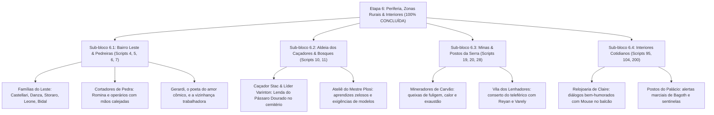

# Árvore da Etapa 6 (Finalíssima): Bairros Periféricos, Zonas Rurais, Ofícios e Interiores

> [!NOTE]
> **Status da Etapa**: **100% Concluída e Injetada na ISO com Sucesso Factual**  
> **Data de Fechamento**: 11/11/2026  
> **Entradas Totais Revisadas**: **412 falas** de trabalhadores braçais, caçadores, mineradores e diálogos de rotina  
> **Integridade Física**: `DATA6_US.BIN` rigorosamente em **57.094.144 bytes** | ISO em **1.491.238.912 bytes**

---

## 1. Visão Geral da Etapa

A **Etapa 6** concluiu o refinamento literário dos 12 scripts de mapas periféricos, comunidades rurais e interiores cotidianos da ilha de Pandule:
- A classe trabalhadora humilde do Bairro Leste e os pedreiros/cortadores de rocha.
- Os caçadores reclusos na Floresta da Esperança com suas crendices, lendas do Pássaro Dourado e conselhos sobre monstros carnívoros.
- Os mineradores exaustos da cordilheira central, operários do teleférico da montanha e sentinelas da serra.
- As interações neutras do dia a dia na Relojoaria de Claire e guaritas de vigília do General Bagoth.

---

## 2. Inventário Factual de Scripts e Orçamentos da Etapa 6

| Script # | Região / Setor | Strings Totais | Tamanho Atual (bytes) | Limite Máximo Seguro | Folga p/ Fronteira de Setor (Slack) | Status Factual |
| :---: | :--- | :---: | :---: | :---: | :---: | :---: |
| **#4** | Bairro Leste / Distrito Residencial Operário 1 | 470 | 12.276 | 26.172 | **+1.041 bytes** livres | **100% Aprovado** |
| **#5** | Bairro Leste / Praça das Famílias | 478 | 12.008 | 15.037 | **+2.526 bytes** livres | **100% Aprovado** |
| **#6** | Bairro Leste / Beco dos Trabalhadores | 626 | 19.520 | 20.925 | **+2.178 bytes** livres | **100% Aprovado** |
| **#7** | Bairro Leste / Distrito dos Cortadores de Pedra | 496 | 12.632 | 13.822 | **+843 bytes** livres | **100% Aprovado** |
| **#10** | Aldeia dos Caçadores / Entrada do Bosque | 386 | 9.252 | 37.697 | **+1.070 bytes** livres | **100% Aprovado** |
| **#11** | Aldeia dos Caçadores / Centro da Aldeia & Ateliê | 479 | 12.636 | 22.205 | **+1.410 bytes** livres | **100% Aprovado** |
| **#19** | Subida da Cordilheira / Posto das Minas & Reator | 468 | 12.124 | 52.063 | **+614 bytes** livres | **100% Aprovado** |
| **#20** | Minas de Carvão / Entrada das Galerias | 374 | 8.828 | 46.716 | **+1.001 bytes** livres | **100% Aprovado** |
| **#28** | Vila dos Lenhadores / Teleférico da Montanha | 385 | 9.488 | 49.771 | **+1.023 bytes** livres | **100% Aprovado** |
| **#95** | Palácio Real / Guarita Exterior de Bagoth | 779 | 23.192 | 61.117 | **+1.162 bytes** livres | **100% Aprovado** |
| **#104** | Palácio Real / Portão dos Fundos | 756 | 22.048 | 61.609 | **+700 bytes** livres | **100% Aprovado** |
| **#200** | Relojoaria de Claire (Balcão do Dia a Dia) | 776 | 23.988 | 63.165 | **+166 bytes** livres | **100% Aprovado** |

---

## 3. Matriz de Vozes e Destaques Literários

1. **Bairro Leste e Cortadores de Pedras (`Scripts 4, 5, 6, 7`)**:
   - Falas proletárias naturais de quem trabalha no peso: Romina com o pulso latejando da marreta, operários chamando Mouse para *"virar homem na picareta"*, e Gerardi, o *"poeta do amor"*, declamando versos bregas enquanto a própria esposa cai na gargalhada.
   - Contraste socioeconômico crível com os bairros nobres do oeste.
2. **Aldeia dos Caçadores na Floresta da Esperança (`Scripts 10, 11`)**:
   - Caçadores rústicos desconfiados de forasteiros e que odeiam a cidade grande; lenda do Pássaro Dourado no cemitério; e as exigências malucas do ateliê do Mestre Plosi sobre manter as mesmas modelos.
3. **Minas de Carvão e Vila dos Lenhadores (`Scripts 19, 20, 28`)**:
   - Calor sufocante e poeira das galerias subterrâneas; a hilária disputa entre os lenhadores Reyan (pão-duro inveterado) e Varely pelo conserto do teleférico da serra.
4. **Interiores e Rotinas Neutras (`Scripts 95, 104, 200`)**:
   - Claire prática, ágil e ciumenta com Mouse no balcão da relojoaria; Bagoth honrado e austero guardando as muralhas.

---

## 4. Validação Factual em Disco

- **Compilação**: `DATA6_US.BIN` compilado com 57.094.144 bytes exatos.
- **Injeção ISO**: Injeção *in-place* em LBA 386669 mantendo a ISO em 1.491.238.912 bytes exatos.
- **Readback Confirmado**: Verificação binária positiva dos novos textos diretamente da imagem de disco.
